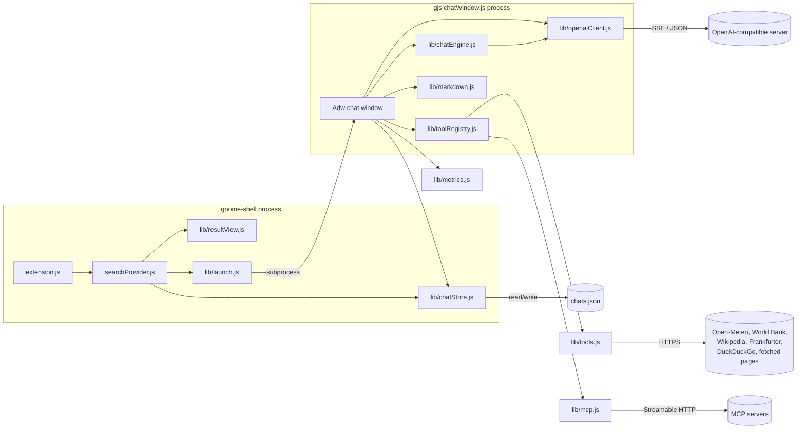
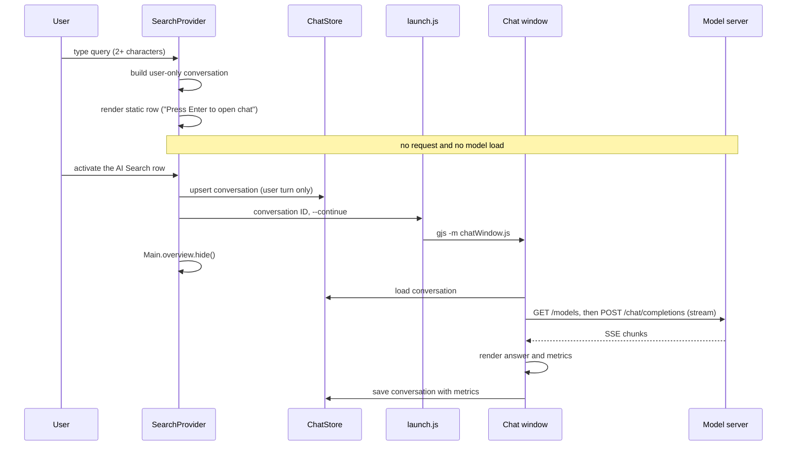

# Architecture

AI Search is a GNOME Shell extension plus a separately launched GTK chat
window. Both processes share the same plain-JS modules under `lib/`. There is no
build step and no external JavaScript dependency.

> **AI-generated project.** Use at your own risk. See the
> [README disclaimer](../README.md) and [SECURITY.md](../SECURITY.md).

## Process model

Why two processes:

- GNOME Shell runs Clutter/St and a GLib main loop. GTK/Adwaita wants its own
  main loop and event handling. Running GTK widgets inside `gnome-shell` is
  fragile, so the chat window is a normal GJS application process.
- A crash or GTK bug in the chat window does not take down the compositor.
- `lib/launch.js` starts `gjs -m chatWindow.js` and forwards a conversation ID,
  the history flag, or a `--continue` flag. `Adw.Application` makes repeated
  launches activate the existing window instead of creating duplicates.
  `--continue` is sent when activating the overview result: the provider hands
  over a conversation that ends on the user's question, and the window answers
  that turn as soon as it opens.

## Request lifecycle

The overview provider never talks to the model. It forwards the typed question
to the chat window, which owns the request.

The provider is created in `extension.js` and registered with
`Main.overview.searchController.addProvider()`. It exposes two results:
`ai-answer` and `ai-chat-history` (`maxResults = 2`).

Key behaviors in `searchProvider.js`:

- Queries shorter than two characters return no results, so neither the AI row
  nor the history row appears.
- `getInitialResultSet()` keeps a conversation in memory with the typed
  question as its only message and renders the row. It sends no request, loads
  no model, and writes nothing to disk.
- The row is static: `AiResultRow` shows the title and **Press Enter to open
  chat**. No answer, reasoning, metrics, or spinner is rendered in the shell
  process.
- The shell caches result actors per result ID, so `AiResultRow` is updated in
  place instead of being recreated on every keystroke.
- Activating `ai-answer` saves the conversation (a single user turn), launches
  the chat window with its ID and `--continue`, and hides the overview, so the
  window is visible without pressing `Escape`. The window loads the model and
  streams the answer.
- Activating `ai-chat-history` launches the window with `--history`.
- `LAUNCH_GUARD_MS` prevents a double activation from opening two windows.
- Disabling the extension destroys the result row display and the chat store.

The overview row is a `St.Button` containing a horizontal `St.BoxLayout` with
an icon, the title, and the status label. It uses a lightweight `Gio.AppInfo`
stand-in so the shell renders it as a full-width list result rather than an
application grid tile.

## Chat loop and tools

`lib/chatEngine.js` runs in the chat window.

1. `buildMessages()` prepends the system prompt, appends the metric or imperial
   instruction selected by `use-imperial-units`, and keeps only `user` and
   `assistant` turns with non-empty text.
2. `OpenAIClient.streamChat()` sends `stream: true` and parses SSE `data:`
   frames. It also handles servers that ignore streaming and return one JSON
   object.
3. Content, reasoning, and tool-call deltas are yielded to the caller.
4. `lib/metrics.js` tracks the turn and yields `{type: 'metrics', metrics}`
   events while streaming; the terminating `done` event carries the final
   metrics object too.
5. If the model requested tools, `chatEngine.js` appends an assistant message
   with `tool_calls`, executes each tool, appends `tool` messages, and starts
   another round.
6. `Maximum tool rounds` caps the loop. Exceeding it yields a notice and a
   `done` event instead of looping.

The metrics object has these fields:

| Field | Meaning |
| --- | --- |
| `ttftMs` | Time from request start to the first streamed token, measured client-side. |
| `elapsedMs` | Wall-clock time for the turn. |
| `promptTokens` | Prompt tokens reported by the server (summed across tool rounds); no estimate is made. |
| `promptTps` | Prompt processing speed in tokens per second. |
| `genTokens` | Generated tokens reported by the server (or an estimate). |
| `genTps` | Generation speed in tokens per second. |
| `contextTokens` | Prompt plus generated tokens used against the context window. |
| `contextWindow` | Discovered context size, when known. |
| `contextPct` | Context used as a percentage; omitted when the window is unknown. |
| `estimated` | True when generated token counts fall back to a ~4-chars-per-token estimate. |
| `rounds` | Number of tool rounds in the turn. |

Values come from the server's `usage` (requested through
`stream_options.include_usage`) and llama.cpp-style `timings` in the final SSE
chunk. TTFT is always measured client-side. Estimates are prefixed with `~` in
the UI. Non-streaming servers can only report TTFT after the whole response
arrives. The context window is discovered best-effort from llama.cpp `/props`
(`default_generation_settings.n_ctx`) or `/models`
(`max_model_len`/`context_length`).

Tool definitions come from `lib/toolRegistry.js`:

- Always: `get_datetime`, `get_system_info`, `get_location` (`get_location`
  queries the desktop's GeoClue2 location service over the system D-Bus and
  requires Location Services to be enabled and permission to be granted).
- With web tools: `get_weather`, `get_country_info`, `search_wikipedia`,
  `web_search`, `fetch_url`, `convert_currency`.
- With MCP enabled: discovered tools renamed to
  `mcp__<sanitized-server>__<sanitized-tool>`, with duplicate names suffixed.

All built-in tools are read-only. `open_application` was removed, so the model
cannot launch desktop applications and GNOME Shell's application search is not
intercepted. `web_search` reads DuckDuckGo's HTML results; `fetch_url` performs
one guarded HTTP GET, rejects loopback/private/link-local/reserved addresses
(including resolved DNS answers and every redirect hop), caps the body at
2 MiB, and returns text only. `get_location` talks only to the local GeoClue2
service on the system D-Bus and performs no network lookup of its own. Neither
tool spawns processes or evaluates code.

## MCP client

`lib/mcp.js` implements the client side of the MCP Streamable HTTP transport:

- `initialize` sends the protocol version (`2024-11-05`), client name, and
  capabilities, then stores the `Mcp-Session-Id` response header.
- Responses can be plain JSON or SSE. The parser handles both.
- `tools/list` discovers tools; `tools/call` executes one.
- Discovery results are cached for five minutes per server URL/header
  combination.
- Up to ten servers are accepted. Invalid entries are skipped unless strict
  parsing is requested by the settings UI.
- Only `http(s)` URLs are allowed; stdio servers are not supported.

MCP tool output is converted to text and truncated to the same
`MAX_TOOL_RESULT_CHARS` limit as built-in tools (8000 characters).

## Chat storage

`lib/chatStore.js` stores conversations in
`$XDG_DATA_HOME/ai-search/chats.json` (normally
`~/.local/share/ai-search/chats.json`).

- Format: `{version: 1, conversations: [...]}`.
- User messages may carry `ts` (epoch milliseconds), used to show when each
  query was asked when the chat is reopened. Messages without it still load and
  simply show no time.
- Unreadable or malformed entries are dropped rather than crashing the shell.
- Writes create the parent directory with mode `0700`, write a `.tmp` file, then
  atomically move it over the real file.
- A `Gio.FileMonitor` invalidates the in-memory cache when the other process
  writes, so the history row and the chat window see each other's changes.
- At most 100 conversations are kept, sorted by `updated`.
- `clear()` empties the list and rewrites the file as
  `{version: 1, conversations: []}`; `remove(id)` drops a single conversation.
  The chat window's history page uses them for **Clear All** and the per-row
  trash button.

Assistant messages may also store a `metrics` object from `lib/metrics.js`, so
reopening a saved chat shows the same per-turn values. Tool calls, tool
results, and reasoning are not persisted.

## Markdown rendering

`lib/markdown.js` is a small renderer shared by Pango (`St.Label`) and GTK:

- It parses headings, paragraphs, emphasis, inline code, fenced code, lists,
  blockquotes, horizontal rules, and pipe tables.
- All input is escaped before it reaches Pango markup.
- Raw HTML is not interpreted.
- Link targets are restricted to `http(s)` and `mailto`.
- Unsupported syntax is shown literally.

This is deliberately not a full CommonMark implementation. It covers the subset
local models produce in practice and keeps the extension dependency-free.

## Settings

The GSettings schema is
`org.gnome.shell.extensions.ai-search` at
`/org/gnome/shell/extensions/ai-search/`. Keys are defined in
`schemas/org.gnome.shell.extensions.ai-search.gschema.xml`.

`prefs.js` builds an Adwaita preferences window with:

- server endpoint, API key, model discovery, and reachability check;
- thinking, reasoning, and tool switches;
- chat history access;
- web tool and MCP configuration, including a save-and-test action;
- a note about plain-text secret storage.

The endpoint normalizer accepts `host:port`, `http(s)://host:port`, a base path,
or a full `.../chat/completions` URL and reduces it to the API root.

## Packaging

- `make schemas` compiles GSettings.
- `make check` validates the schema strictly and builds the release zip.
- `make pack` runs `gnome-extensions pack` and writes
  `dist/<uuid>.shell-extension.zip`.
- `make install` copies the extension into the user's extension directory and
  installs the **AI Chats** desktop entry.

The extension has no npm, pip, or system package dependencies beyond the GNOME
platform libraries already present on a GNOME Shell system.

## Known design tradeoffs

- The overview is a launcher, not a viewer: the shell process never calls the
  model. The chat window owns every request, transcript, and tool detail, and
  loading starts when it opens.
- The extension does not manage model servers or downloads. This keeps it
  compatible with Unsloth Studio, llama.cpp, Ollama, LM Studio, and anything
  else that speaks the same API, but startup/loading is the server's job.
- Chat history is a single JSON file. It is simple and inspectable, but not
  suitable for very large histories or multi-user machines.
- Settings, including secrets, live in dconf. This matches GNOME extension
  conventions but is not secure storage.
- Metrics depend on server cooperation. Without `usage`/`timings`, generated
  counts and speeds are estimates, and a context percentage needs a context
  size from `/props` or `/models`.
- GNOME Shell's search-provider API is not stable across major releases. The
  extension targets the current `addProvider()` API.
