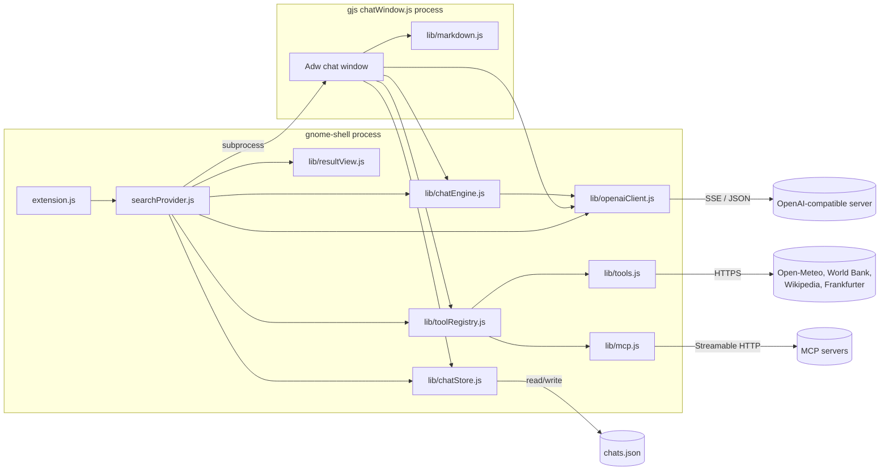
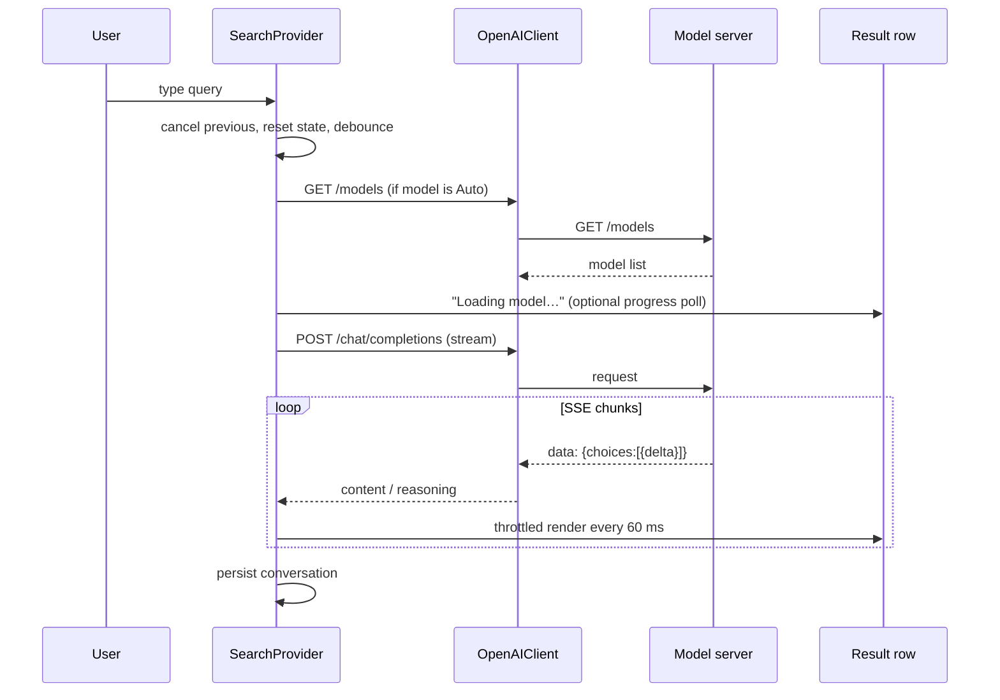

# Architecture

AI Search is a GNOME Shell 50 extension plus a separately launched GTK chat
window. Both processes share the same plain-JS modules under `lib/`. There is no
build step and no external JavaScript dependency.

> **AI-generated project.** Use at your own risk. See the
> [README disclaimer](../README.md) and [SECURITY.md](../SECURITY.md).

## Process model

Why two processes:

- GNOME Shell runs Clutter/St and a GLib main loop. GTK/Adwaita wants its own
  main loop and event handling. Running GTK widgets inside `gnome-shell` is
  fragile, so the chat window is a normal GJS application process.
- A crash or GTK bug in the chat window does not take down the compositor.
- `lib/launch.js` starts `gjs -m chatWindow.js` and forwards a conversation ID,
  the history flag, or a `--continue` flag. `Adw.Application` makes repeated
  launches activate the existing window instead of creating duplicates.
  `--continue` is sent when the saved conversation still ends on the user's
  question (the overview result was activated before the debounce fired or
  before any token arrived); the window then answers that turn as soon as it
  opens.

## Request lifecycle

The provider is created in `extension.js` and registered with
`Main.overview.searchController.addProvider()`. It exposes two results:
`ai-answer` and `ai-chat-history` (`maxResults = 2`).

Key behaviors in `searchProvider.js`:

- Queries shorter than two characters produce no AI request.
- `getInitialResultSet()` cancels any in-flight request, resets the answer, and
  schedules a new one after the configured debounce.
- A monotonically increasing `_serial` prevents a late response from an older
  query from overwriting a newer one.
- The shell caches result actors per result ID, so `AiResultRow` is updated in
  place instead of being recreated on every keystroke.
- Rendering is throttled (`FLUSH_INTERVAL_MS = 60`) while streaming.
- Answer and reasoning text are capped (`MAX_ANSWER_CHARS`,
  `MAX_REASONING_CHARS`) before rendering.
- Disabling the extension cancels requests, stops the model watcher, finalizes
  the conversation, and destroys the chat store and HTTP client.
- `LAUNCH_GUARD_MS` prevents a double activation from opening two windows.

The overview row is a `St.Button` containing a `St.BoxLayout`. It uses a
lightweight `Gio.AppInfo` stand-in so the shell renders it as a full-width list
result rather than an application grid tile.

## Chat loop and tools

`lib/chatEngine.js` is shared by the overview and the chat window.

1. `buildMessages()` prepends the system prompt and keeps only `user` and
   `assistant` turns with non-empty text.
2. `OpenAIClient.streamChat()` sends `stream: true` and parses SSE `data:`
   frames. It also handles servers that ignore streaming and return one JSON
   object.
3. Content, reasoning, and tool-call deltas are yielded to the caller.
4. If the model requested tools, `chatEngine.js` appends an assistant message
   with `tool_calls`, executes each tool, appends `tool` messages, and starts
   another round.
5. `Maximum tool rounds` caps the loop. Exceeding it yields a notice and a
   `done` event instead of looping.

Tool definitions come from `lib/toolRegistry.js`:

- Always: `get_datetime`, `get_system_info`, `open_application`.
- With web tools: `get_weather`, `get_country_info`, `search_wikipedia`,
  `convert_currency`.
- With MCP enabled: discovered tools renamed to
  `mcp__<sanitized-server>__<sanitized-tool>`, with duplicate names suffixed.

`open_application` is the only tool with a side effect. It searches
`Gio.AppInfo.get_all()` for a matching desktop entry and calls `launch()`.

## MCP client

`lib/mcp.js` implements the client side of the MCP Streamable HTTP transport:

- `initialize` sends the protocol version (`2024-11-05`), client name, and
  capabilities, then stores the `Mcp-Session-Id` response header.
- Responses can be plain JSON or SSE. The parser handles both.
- `tools/list` discovers tools; `tools/call` executes one.
- Discovery results are cached for five minutes per server URL/header
  combination.
- Up to ten servers are accepted. Invalid entries are skipped unless strict
  parsing is requested by the settings UI.
- Only `http(s)` URLs are allowed; stdio servers are not supported.

MCP tool output is converted to text and truncated to the same
`MAX_TOOL_RESULT_CHARS` limit as built-in tools (8000 characters).

## Chat storage

`lib/chatStore.js` stores conversations in
`$XDG_DATA_HOME/ai-search/chats.json` (normally
`~/.local/share/ai-search/chats.json`).

- Format: `{version: 1, conversations: [...]}`.
- Unreadable or malformed entries are dropped rather than crashing the shell.
- Writes create the parent directory with mode `0700`, write a `.tmp` file, then
  atomically move it over the real file.
- A `Gio.FileMonitor` invalidates the in-memory cache when the other process
  writes, so the overview and chat window see each other's changes.
- At most 100 conversations are kept, sorted by `updated`.

Only `role` and `content` are stored per message. Tool calls, tool results, and
reasoning are not persisted.

## Markdown rendering

`lib/markdown.js` is a small renderer shared by Pango (`St.Label`) and GTK:

- It parses headings, paragraphs, emphasis, inline code, fenced code, lists,
  blockquotes, horizontal rules, and pipe tables.
- All input is escaped before it reaches Pango markup.
- Raw HTML is not interpreted.
- Link targets are restricted to `http(s)` and `mailto`.
- Unsupported syntax is shown literally.

This is deliberately not a full CommonMark implementation. It covers the subset
local models produce in practice and keeps the extension dependency-free.

## Settings

The GSettings schema is
`org.gnome.shell.extensions.ai-search` at
`/org/gnome/shell/extensions/ai-search/`. Keys are defined in
`schemas/org.gnome.shell.extensions.ai-search.gschema.xml`.

`prefs.js` builds an Adwaita preferences window with:

- server endpoint, API key, model discovery, and reachability check;
- debounce, thinking, reasoning, and tool switches;
- chat history access;
- web tool and MCP configuration, including a save-and-test action;
- a note about plain-text secret storage.

The endpoint normalizer accepts `host:port`, `http(s)://host:port`, a base path,
or a full `.../chat/completions` URL and reduces it to the API root.

## Packaging

- `make schemas` compiles GSettings.
- `make check` validates the schema strictly and builds the release zip.
- `make pack` runs `gnome-extensions pack` and writes
  `dist/<uuid>.shell-extension.zip`.
- `make install` copies the extension into the user's extension directory and
  installs the **AI Chats** desktop entry.

The extension has no npm, pip, or system package dependencies beyond the GNOME
platform libraries already present on a GNOME Shell 50 system.

## Known design tradeoffs

- The overview row is single-answer by design; the chat window is the place for
  transcripts and tool details.
- The extension does not manage model servers or downloads. This keeps it
  compatible with Unsloth Studio, llama.cpp, Ollama, LM Studio, and anything
  else that speaks the same API, but startup/loading is the server's job.
- Chat history is a single JSON file. It is simple and inspectable, but not
  suitable for very large histories or multi-user machines.
- Settings, including secrets, live in dconf. This matches GNOME extension
  conventions but is not secure storage.
- GNOME Shell's search-provider API is not stable across major releases. The
  extension targets Shell 50's `addProvider()` API only.
